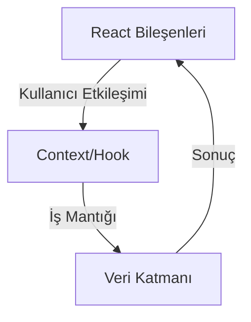

# Yazılım Mimarisi ve Teknik Detaylar

Bu doküman, Enterprise Fleet System projesinin yazılım mimarisini, katmanlarını, veri akışını ve önemli teknik kararlarını detaylı şekilde açıklar.

## Genel Bakış
Enterprise Fleet System, filo yönetimi ve araç takibi için geliştirilen, ölçeklenebilir ve modüler bir web uygulamasıdır. Modern frontend teknolojileriyle geliştirilmiş olup, kolay genişletilebilirlik ve sürdürülebilirlik hedeflenmiştir.

## Katmanlı Mimari

1. **Sunum Katmanı (Frontend)**
   - Next.js tabanlı, SSR ve SSG desteğiyle hızlı ve SEO uyumlu arayüz.
   - React bileşenleri ile modüler yapı.
   - Tailwind CSS ile özelleştirilebilir ve tutarlı stil yönetimi.

2. **İş Mantığı Katmanı**
   - Context API ve özel hook'lar ile global durum ve iş mantığı yönetimi.
   - `src/context/` ve `src/hooks/` klasörlerinde konumlanır.

3. **Veri Katmanı**
   - Mock veriler ve sabitler `src/constants/` altında tutulur.
   - Gerçek API ve veri tabanı entegrasyonları için altyapı hazırdır.

## Veri Akışı

Kullanıcı arayüzünde yapılan işlemler (ör. araç ekleme) ilgili React bileşeninde tetiklenir, iş mantığı hook veya context ile yönetilir, veri katmanına aktarılır ve sonuç arayüze yansıtılır.

```
Kullanıcı → React Bileşeni → Hook/Context → Veri Katmanı → UI Güncelleme
```

## Önemli Bileşenler ve Modüller

- **Araç Yönetimi**: Araç ekleme, düzenleme, silme, detay görüntüleme
- **Sürücü Yönetimi**: Sürücü ekleme, düzenleme, araç atama
- **Bakım Takvimi**: Takvim tabanlı bakım ve servis takibi
- **Raporlama**: Filo maliyetleri, sağlık durumu ve finansal analiz
- **Ayarlar**: Kullanıcı ve sistem ayarları

## Klasör Yapısı ve Sorumluluklar

- `src/app/` : Sayfa ve route yönetimi
- `src/components/` : Tekrar kullanılabilir UI bileşenleri (dashboard, kartlar, sidebar vb.)
- `src/constants/` : Sabitler ve mock veriler
- `src/context/` : Global state/context yönetimi
- `src/hooks/` : Özel React hook'ları
- `src/lib/` : Yardımcı fonksiyonlar ve utilitiler

## Tasarım Kararları

- **Bileşen Tabanlılık**: Her işlevsel parça bağımsız bileşen olarak tasarlanır.
- **Tip Güvenliği**: Tüm kod TypeScript ile yazılır.
- **Kolay Genişletilebilirlik**: Yeni modül ve özellikler minimum bağımlılıkla eklenebilir.
- **Performans**: Next.js ile SSR/SSG, kod bölme ve önbellekleme kullanılır.

## Genişletilebilirlik ve Entegrasyon

- Yeni modüller ve bileşenler kolayca eklenebilir.
- API ve veri tabanı entegrasyonu için hazır altyapı.
- Test ve CI/CD entegrasyonu için uygun yapı.

## Diyagram Önerisi



## Notlar
- Kodun okunabilirliği ve sürdürülebilirliği ön planda tutulmuştur.
- Her modül bağımsız olarak geliştirilebilir ve test edilebilir.

## Lisans
MIT